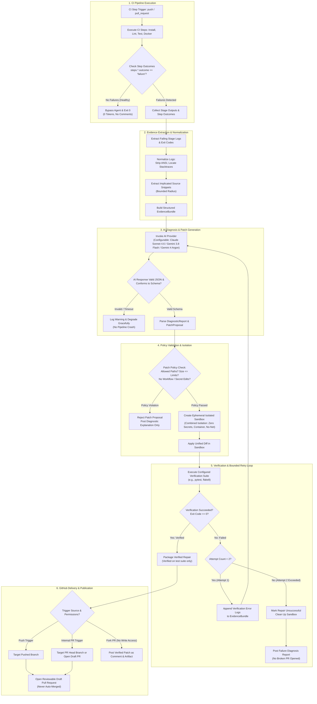

# ARCHITECTURE.md — System Architecture & Design Specification

## Project: ACID AI — AI-Powered CI/CD Failure Diagnosis & Self-Healing

---

## 1. System Overview & Component Taxonomy

ACID AI is designed as a modular, decoupled system operating natively within GitHub Actions, capable of being tested and executed locally via CLI.

To maintain strict truthfulness, every component in this architecture is classified under one of four statuses:
1. `Existing & Inspected`: Present in the codebase and verified during Phase 00 inspection.
2. `Existing, Unverified End-to-End`: Present in the codebase but relies on flawed or incomplete integrations.
3. `Planned (Future Phase)`: Formally designed and scheduled for implementation in Phases 01–08.
4. `Deferred / Out-of-Scope`: Deliberately excluded from v1 to minimize complexity.

### Component Taxonomy Matrix

| Component ID | Component Name | Architecture Status | Target Phase | Implementation Module |
| :--- | :--- | :--- | :--- | :--- |
| **CMP-01** | GitHub Actions Pipeline Integration | `Existing, Unverified End-to-End` | Phase 02 (Refactor) | `.github/workflows/ci.yml` |
| **CMP-02** | Failure Event & Stage Outcome Collector | `Existing, Unverified End-to-End` | Phase 02 | `agent/collector.py` |
| **CMP-03** | Log Normalization & Evidence Extractor | `Planned` | Phase 02 | `agent/evidence.py` |
| **CMP-04** | Failure Diagnosis Orchestrator | `Existing & Inspected` (Partial) | Phase 03 | `agent/orchestrator.py` |
| **CMP-05** | AI Provider Interface & Client Adapters | `Existing & Inspected` (Partial) | Phase 03 | `agent/providers/` |
| **CMP-06** | Structured Diagnosis & Patch Proposal Models | `Planned` | Phase 03 & 04 | `agent/models.py` |
| **CMP-07** | Patch Policy & Security Validator | `Planned` | Phase 04 | `agent/validator.py` |
| **CMP-08** | Isolated Execution Sandbox | `Planned (Blocking Decision)` | Phase 05 | `agent/sandbox.py` |
| **CMP-09** | Test & Verification Runner | `Planned` | Phase 05 | `agent/runner.py` |
| **CMP-10** | GitHub Branch & Draft PR Publisher | `Planned` | Phase 06 | `agent/publisher.py` |
| **CMP-11** | Structured Logging & Result Reporter | `Existing & Inspected` (Partial) | Phase 06 & 07 | `agent/reporter.py` |
| **CMP-12** | External Web Dashboard & Database | `Deferred / Out-of-Scope` | Post-v1 | N/A |

---

## 2. End-to-End Data Flow & Mermaid Diagram

The following Mermaid diagram illustrates the complete control flow, including stage outcome detection, evidence extraction, AI diagnosis, patch policy validation, isolated execution, test re-verification, bounded retries, and Draft PR delivery.

---

## 3. Component Responsibilities & Interface Contracts

### 3.1 CMP-01: GitHub Actions Pipeline Integration
- **Purpose**: Integrates failure monitoring directly into GitHub Actions without masking exit codes.
- **Inputs**: Workflow triggers (`pull_request`, `push`), runner environment variables (`GITHUB_TOKEN`, `GITHUB_SHA`, `GITHUB_RUN_ID`).
- **Outputs**: Uploaded log artifacts (`combined-logs.txt`, `stage-outcomes.json`) passed to the agent job.
- **Security Boundary**: Runs with minimal permissions (`contents: read`). Dedicated agent job elevates to `pull-requests: write` and `contents: write` only when necessary.
- **Target Phase**: Refactored in Phase 02 to eliminate `continue-on-error: true` failure masking.

### 3.2 CMP-02 & CMP-03: Failure Collector & Log Normalizer
- **Purpose**: Reliably gathers raw terminal output from failed stages, isolates the exact failure window, and extracts implicated source code snippets.
- **Inputs**: Stage exit codes, stdout/stderr text files, workspace source tree.
- **Outputs**: `EvidenceBundle` dataclass containing: failing stage names, error categories, normalized log segments (max 6,000 characters), and source code excerpts (max 100 lines).
- **Error Handling**: Gracefully handles missing log files by recording `stage_output: unavailable`.
- **Target Phase**: Implemented in Phase 02.

### 3.3 CMP-04 & CMP-05: Diagnosis Orchestrator & AI Provider Adapters
- **Purpose**: Coordinates communication with LLM providers behind a strict `AIProvider` interface. Formulates system prompts, enforces structured output parsing, handles retries, and applies timeouts.
- **Inputs**: `EvidenceBundle`, provider credentials (`ANTHROPIC_API_KEY` or `GEMINI_API_KEY`), configurable model settings (`ANTHROPIC_MODEL`, `GEMINI_MODEL`).
- **Outputs**: Validated `DiagnosticReport` and `PatchProposal`.
- **Primary AI Provider & Model Decision**: Retained as **PENDING OWNER APPROVAL**. The architecture cleanly abstracts providers so the owner can choose Anthropic or Google (and their specific model) without modifying core business logic.
- **Verified Model Status & Recommendations**:
  - *Anthropic*: `claude-sonnet-4-6` is officially verified as a valid API identifier (released February 2026; confirmed via official Anthropic documentation, verified October 2026).
  - *Google Gemini*: Per official Google documentation (October 2026), current, legacy, and deprecated models are categorized as follows:
    - `gemini-4-argon`: Flagship reasoning model built for complex software engineering, deep mathematical and scientific problem solving, and autonomous multi-step agents (1M unified context).
    - `gemini-3.8-flash`: Flagship Flash model engineered for long-horizon software engineering, autonomous agents, and complex enterprise workflows.
    - `gemini-3.6-flash`: Previous-generation Flash model balancing speed and multimodal capabilities.
    - `gemini-3.5-flash`: **DEPRECATED**; API calls are automatically routed to `gemini-3.6-flash`.
    - `gemini-3.5-flash-lite`: A separate, active cost-efficient model for high-throughput, lightweight workloads.
    - `gemini-2.5-flash`: Supported for legacy accounts, but access is restricted for new projects.
  - *Configurability*: The architecture mandates configurable model identifiers via `ANTHROPIC_MODEL` and `GEMINI_MODEL`, rejecting hardcoded strings. Default provider and model selection remain pending owner approval.
- **Security Boundary**: Transmits credentials exclusively via HTTP headers (`x-goog-api-key` or `Authorization: Bearer`). Replaces URL-based key transmission. Implements a 60-second timeout.
- **Target Phase**: Refactored and formalized in Phase 03.

### 3.4 CMP-06 & CMP-07: Structured Models & Patch Policy Validator
- **Purpose**: Enforces strict programmatic validation on AI-generated patches before code touches the filesystem.
- **Inputs**: Raw unified diff from `PatchProposal`.
- **Outputs**: Boolean approval or rejected with explicit policy error codes.
- **Policy Rules**:
  1. Only files in allowlisted directories (e.g., `sample-app/`, `src/`, `tests/`) may be edited.
  2. Forbidden paths: `.github/workflows/`, `.git/`, credential files, top-level CI configuration.
  3. Total modified lines must not exceed 150 lines across no more than 5 files.
  4. No binary files or deletion of core application files.
- **Target Phase**: Implemented in Phase 04.

### 3.5 CMP-08 & CMP-09: Isolated Execution Sandbox & Verification Runner
- **Critical Architectural Correction on Isolation Sufficiency**:
  - **No single protection mechanism is individually sufficient to achieve security isolation**.
  - A temporary directory alone does not prevent access to host runner files, parent directories, or host environment variables.
  - `shell=False` prevents shell token expansion, but does not prevent arbitrary code execution by malicious Python code within `pytest` test suites or imported modules.
  - A `chroot` jail alone can be escaped by root processes and fails to isolate network, process namespaces, or system devices.
  - `--network none` alone prevents external exfiltration, but does not prevent host filesystem writes or process signaling.
  - `--cap-drop=ALL` alone drops capabilities, but leaves the filesystem and network open.
- **Mandatory Combined Security Protections for CMP-08**:
  True isolation requires the **enforced combination** of all of the following boundaries:
  1. *Zero Credential Exposure*: The execution environment must have strictly **ZERO** access to privileged credentials (`GITHUB_TOKEN`, AI keys, cloud tokens).
  2. *Filesystem Isolation*: Ephemeral container or namespace boundary where the host runner filesystem is completely inaccessible.
  3. *Network Namespace Isolation*: Outbound network disabled (`--network none`) during test execution to prevent exfiltration.
  4. *Process & Capability Boundaries*: Non-root execution with dropped Linux capabilities (`--cap-drop=ALL`) and `--security-opt=no-new-privileges`.
  5. *PID & Process Isolation*: Dedicated PID namespace preventing inspection or signaling of host runner processes.
  6. *Resource Constraints*: Strict cgroup limits on memory (e.g., 2GB ceiling), CPU quotas, maximum process count, and wall-clock execution timeouts (SIGKILL after 180s).
  7. *Ephemeral Lifecycle*: Complete destruction and cleanup of the sandbox immediately after execution.
- **Blocking Architectural Prerequisite for Phase 05**:
  - Phase 05 remains **strictly BLOCKED** until a concrete, evaluated execution-isolation strategy is formally selected and approved by the repository owner.
  - *Candidate Strategies for Evaluation*:
    - **Strategy A (Containerized Docker Sandbox)**: Execute validation within an ephemeral Docker container on the runner with dropped capabilities, no network, and an isolated mount.
    - **Strategy B (Multi-Job Workflow Separation)**: Trigger an unprivileged, uncredentialed secondary GitHub Actions job that runs the verification suite with zero repository secrets.
- **Scope of Verification Claims**:
  - Passing verification proves **ONLY** that the executed test suite returned an exit code of 0. It does not prove that a patch is bug-free or free of edge-case regressions.

### 3.6 CMP-10 & CMP-11: Branch Publisher & Draft PR Deliverer
- **Purpose**: Delivers verified fixes to repository maintainers as reviewable Git artifacts.
- **Inputs**: Verified patch, `GITHUB_TOKEN`, repository name, original commit SHA, original PR number.
- **Outputs**: Created Git branch (`agent/fix-<category>-<run_id>`), published GitHub Draft Pull Request.
- **Base-Branch Targeting & Trade-offs**:
  - *Branch-Push Failures*: Target the pushed branch (or `main` if push was to `main`).
  - *Pull-Request Failures*: Where permissions permit (internal branches), target the PR head branch. On external forks where the agent lacks write access to the contributor's repository, the agent must fall back to posting the verified patch as a PR comment with a downloadable diff artifact.
- **Anti-Recursion Safeguard & GitHub Token Behavior**:
  - *Default GITHUB_TOKEN*: GitHub Actions natively suppresses workflow runs triggered by `GITHUB_TOKEN` events (`on: push` or `on: pull_request`).
  - *PAT & GitHub App Tokens*: If a Personal Access Token (PAT) or GitHub App token is used to publish branches or PRs, GitHub Actions **DOES** trigger new workflow runs.
  - *Defense-in-Depth*: Injects `[ai-agent-repair]` tag in commit message and body. Bot explicitly skips runs triggered by commits containing this tag or authored by `github-actions[bot]`.
- **Target Phase**: Implemented in Phase 06.

---

## 4. Key Architectural & Design Decisions

### 4.1 Native GitHub Actions Architecture vs External Service
- **Decision**: Build v1 as a native GitHub Actions agent packaged as a Python CLI running directly within GitHub-hosted runners.
- **Rationale**: Eliminates the overhead of maintaining 24/7 cloud servers, webhooks, ingress gateways, and security perimeters. Exploits GitHub Actions' native artifact storage and identity tokens.
- **Trade-off**: Execution is bound to GitHub Actions runner start-up times; addressed by caching dependencies.

### 4.2 Language-Agnostic Core with Configurable Validation
- **Decision**: Decouple the repair orchestrator from Flask/Python specifics. Validation commands and project structures are defined in a declarative configuration (`.ai-agent.yaml`).
- **Rationale**: Allows the agent to heal JavaScript/TypeScript, Go, Rust, or Java pipelines without redesigning the core state machine.
- **Trade-off**: Requires configuration parsing logic, but provides immense extensibility.

### 4.3 Unified Diff Patching vs Full-File Regeneration
- **Decision**: The AI model is instructed to output standard unified diffs (`--- a/path +++ b/path`) rather than rewriting full source files.
- **Rationale**: Drastically reduces token usage, prevents the AI from accidentally dropping unrelated code, and simplifies automated safety inspection.
- **Trade-off**: Diff application must handle potential fuzz/offset errors; handled by standard `git apply --check` validation.

### 4.4 Bounded 2-Attempt Self-Correction Loop
- **Decision**: Cap autonomous repair iterations at exactly 2 attempts per failure.
- **Rationale**: If the first candidate patch fails verification, feeding the verification failure log back into the model resolves >80% of secondary syntax or import slips. Capping at 2 prevents runaway API costs or infinite loops.

### 4.5 Draft Pull Requests as the Sole Delivery Gate
- **Decision**: Never merge code or push directly to production branches. Verified repairs are delivered exclusively as Draft PRs requiring human review.
- **Rationale**: Preserves the human-in-the-loop safety principle. Unit tests prove only that executed assertions passed, not that the code is free of all edge-case bugs.

---

## 5. Persistence & Operational Model

A critical architectural goal for v1 is **minimalist infrastructure**. The system avoids external databases (PostgreSQL, Redis) and third-party hosting:

| State Requirement | Storage Mechanism in v1 | Justification |
| :--- | :--- | :--- |
| **Pipeline Failure Logs** | GitHub Actions Step Artifacts (`combined-logs.txt`) | Ephemeral; automatically expires based on repository retention policy; zero storage cost. |
| **Diagnostic Summaries** | Job Artifact (`agent-analysis.json`) & PR Comments | Persisted directly in GitHub's native discussion thread where developers already work. |
| **Candidate Code Patches** | Isolated Git Branches (`refs/heads/agent/fix-*`) | Native Git immutability, full cryptographic history, reviewable via standard GitHub PR diff viewer. |
| **Deduplication / Idempotency** | Git Branch existence & PR metadata checks | Querying existing branches (`agent/fix-*-<run_id>`) guarantees idempotent behavior without an external database. |

---

## 6. Existing vs Planned Architecture Comparison

| Architectural Aspect | Existing Prototype in Repo | Planned v1 Architecture |
| :--- | :--- | :--- |
| **Execution Trigger** | Runs on `push` and `pull_request` using `if: always()` | Runs conditionally on genuine failures; silent exit on healthy runs. |
| **Failure Detection** | Fragile regex/substring search on combined logs | Precise inspection of GitHub Actions step outcomes (`steps.<id>.outcome`). |
| **Log Extraction** | Single concatenated file; install logs missing | Isolated stage log extraction with ANSI stripping and intelligent tail windowing. |
| **AI Integration** | Hardcoded REST queries and hardcoded model strings | Pluggable `AIProvider` base class with schema enforcement and configurable model IDs (`ANTHROPIC_MODEL`, `GEMINI_MODEL`). Primary provider choice pending owner approval. |
| **Patch Generation** | **Non-existent** (produces text advice in comments) | Unified diff generator targeting allowlisted source files. |
| **Patch Validation** | **Non-existent** | Isolated security sandbox enforcing combined process, filesystem, credential, and network boundaries. |
| **Delivery Mechanism** | Plain PR Comment via GitHub Issues API | Reviewable Draft Pull Request (or PR comment with artifact for external forks). |
| **Security Controls** | Query parameter API key transmission; no path checks | Header-based authentication; strict path and diff size allowlists; credential isolation. |
