# ROADMAP.md — Engineering Development Roadmap

## Project: ACID AI — AI-Powered CI/CD Failure Diagnosis & Self-Healing

---

## 1. Overview & Phased Execution Strategy

This roadmap establishes the formal, sequential implementation plan spanning **Phases 00 through 08**.
In accordance with [AGENTS.md](AGENTS.md), each phase represents an isolated development milestone governed by strict acceptance criteria, testing requirements, and exit conditions.

**Advancing between phases requires explicit human user authorization.** Under no circumstances may an automated agent proceed to a subsequent phase without formal review.

```mermaid
graph LR
    P0[Phase 00: Spec & Governance] --> P1[Phase 01: Test Foundation]
    P1 --> P2[Phase 02: Accurate Detection]
    P2 --> P3[Phase 03: Diagnosis Engine]
    P3 --> P4[Phase 04: Patch Engine]
    P4 --> P5[Phase 05: Sandbox Verification]
    P5 --> P6[Phase 06: GitHub Draft PR]
    P6 --> P7[Phase 07: Security & Reliability]
    P7 --> P8[Phase 08: Release Readiness]
```

---

## Phase 00 — Product Specification, Architecture & Development Governance

- **Objective**: Establish product requirements, complete system architecture, threat model, configuration schema, and permanent development governance before modifying application code.
- **Prerequisites**: Access to the cloned repository and working Git environment.
- **Scope**:
  - Verification of repository status and existing triage prototype code.
  - Creation and review of [AGENTS.md](AGENTS.md), [docs/DEVELOPMENT_PROTOCOL.md](docs/DEVELOPMENT_PROTOCOL.md), and [docs/PHASE_STATUS.md](docs/PHASE_STATUS.md).
  - Creation and review of [PROJECT_REQUIREMENTS.md](PROJECT_REQUIREMENTS.md), [ARCHITECTURE.md](ARCHITECTURE.md), [ROADMAP.md](ROADMAP.md), [THREAT_MODEL.md](THREAT_MODEL.md), and [docs/CONFIGURATION.md](docs/CONFIGURATION.md).
  - Read-only verification of previous audit claims and correction of factual errors (validity of `claude-sonnet-4-6`, official Gemini model recommendations, combined sandbox isolation requirements, GitHub Actions token recursion behavior).
- **Expected Deliverables**: 8 comprehensive planning and governance documents in markdown format.
- **Relevant Files**: All root specification files and `docs/` subdirectory.
- **Required Tests**: Read-only validation of existing files; no application code changes.
- **Measurable Acceptance Criteria**:
  1. All 8 documents created, properly hyperlinked, and mutually consistent.
  2. All baseline audit claims verified against actual source code and official vendor documentation with line-numbered citations.
  3. No modification to application source code, workflow files, or dependency manifests.
- **Security Considerations**: Ensure no real API keys, secrets, or internal URLs are exposed in documentation.
- **Known Risks & Blockers**: Discrepancies between existing prototype behavior and target v1 vision; addressed by explicit component taxonomy.
- **Dependencies**: None.
- **Exit Conditions**: User reviews Phase 00 review report and provides explicit approval to begin Phase 01.

---

## Phase 01 — Foundation and Test Suite Baseline

- **Objective**: Establish a robust, reproducible development environment, explicit pinned dependencies, and automated test infrastructure with mock fixtures.
- **Prerequisites**: User approval of Phase 00.
- **Scope**:
  - Restructure agent into a clean Python package (`agent/` with `__init__.py`, `cli.py`, `models.py`).
  - Formalize dependency manifests (`requirements.txt`, `requirements-dev.txt`, or `pyproject.toml`).
  - Configure `pytest`, `pytest-mock`, and coverage reporting.
  - Implement static test fixtures simulating diverse CI logs: healthy run, missing dependency, flake8 style error, pytest assertion failure, Docker build failure.
  - Establish a hermetic baseline unit test suite verifying that existing prototype functions can be exercised with mocks.
- **Expected Deliverables**:
  - `agent/` package structure with type annotations.
  - `tests/` directory with `tests/unit/` and `tests/fixtures/`.
  - Pinned `requirements.txt` and `requirements-dev.txt`.
- **Relevant Files**: `agent/`, `tests/`, `requirements.txt`.
- **Required Tests**: `pytest tests/unit/ -v` achieving clean execution with zero network calls.
- **Measurable Acceptance Criteria**:
  1. Development dependencies install cleanly in a fresh virtualenv.
  2. Test suite executes in < 5 seconds with 100% passing tests.
  3. All external network calls (Anthropic, Gemini, GitHub) are mocked or abstracted.
- **Security Considerations**: Ensure development scripts do not set default hardcoded API keys.
- **Known Risks & Blockers**: Inconsistencies between Python versions (Python 3.11 in CI vs local environment).
- **Dependencies**: Phase 00.
- **Exit Conditions**: Full test suite passes; Phase 01 completion report submitted and approved.

---

## Phase 02 — Accurate Failure Detection and Log Collection

- **Objective**: Eliminate false positives on healthy builds, properly capture all stage logs, and implement truthful CI status reporting.
- **Prerequisites**: Phase 01 test suite baseline.
- **Scope**:
  - Refactor `.github/workflows/ci.yml` to remove `continue-on-error: true` from steps where it masks job failure.
  - Implement step conclusion inspection using GitHub Actions step contexts (`steps.<id>.outcome == 'failure'`).
  - Implement dedicated log collectors for every pipeline stage (`install-output.txt`, `lint-output.txt`, `test-output.txt`, `docker-output.txt`).
  - Build `agent/collector.py` and `agent/evidence.py` to normalize logs, strip ANSI escape codes, locate stack traces, and extract relevant source code context.
  - Implement healthy pipeline bypass: agent exits immediately with code 0 if all stages succeeded.
- **Expected Deliverables**:
  - Updated `.github/workflows/ci.yml`.
  - `agent/collector.py` and `agent/evidence.py`.
  - Unit tests for log normalization and failure detection.
- **Relevant Files**: `.github/workflows/ci.yml`, `agent/collector.py`, `agent/evidence.py`, `tests/unit/test_collector.py`.
- **Required Tests**: Unit tests verifying that healthy log fixtures yield 0 detected failures and exit immediately.
- **Measurable Acceptance Criteria**:
  1. 100% of healthy log fixtures pass through classifier without triggering false failures.
  2. Install logs are accurately captured and separate from lint logs.
  3. CI pipeline accurately reports failed status when tests or linter fail.
- **Security Considerations**: Prevent log collectors from reading files outside repository boundaries.
- **Known Risks & Blockers**: Large log files exceeding memory limits; mitigated by streaming log reader with tail windowing.
- **Dependencies**: Phase 01.
- **Exit Conditions**: Phase 02 completion report approved by user.

---

## Phase 03 — AI Diagnosis Engine

- **Objective**: Implement a structured, evidence-grounded root cause diagnosis engine behind an extensible provider abstraction.
- **Prerequisites**: Phase 02 failure detection and evidence collection.
- **Scope**:
  - Define `AIProvider` abstract base class with standard `diagnose(evidence: EvidenceBundle) -> DiagnosticReport` interface.
  - Implement primary provider adapter for Anthropic Claude using verified model identifier (`claude-sonnet-4-6` by default, or configurable via `ANTHROPIC_MODEL`) and official SDK.
  - Implement provider adapter for Google Gemini using header authentication (`x-goog-api-key`) and official SDK, eliminating URL query parameter key transmission. Support current models (`gemini-4-argon` flagship reasoning, `gemini-3.8-flash` agent/coding Flash, `gemini-3.6-flash`, `gemini-3.5-flash-lite`), legacy `gemini-2.5-flash`, and handle deprecated `gemini-3.5-flash` (auto-routed to `gemini-3.6-flash`). Default provider and model selection remain pending repository owner approval.
  - Retain default AI provider selection as pending repository owner approval.
  - Implement Pydantic schema validation for diagnostic responses (`DiagnosticReport`, `FailureCategory`, `SuggestedFix`).
  - Implement explicit timeouts (60s), rate-limit retry logic (exponential backoff), and graceful error handling.
- **Expected Deliverables**:
  - `agent/providers/base.py`, `agent/providers/anthropic.py`, `agent/providers/gemini.py`.
  - `agent/models.py` with Pydantic domain models.
  - Comprehensive unit tests with mocked provider responses.
- **Relevant Files**: `agent/providers/`, `agent/models.py`, `agent/orchestrator.py`.
- **Required Tests**: Unit tests asserting schema parsing, timeout handling, and malformed JSON recovery.
- **Measurable Acceptance Criteria**:
  1. Configurable model selection enabled via `ANTHROPIC_MODEL` and `GEMINI_MODEL`.
  2. Gemini API key transmission in URL query parameters completely eliminated.
  3. Missing or empty environment variables (`AI_PROVIDER=""`) handled gracefully with descriptive error.
  4. Diagnosis returns validated Pydantic object with cited log lines.
- **Security Considerations**: Validate that API keys are never printed in debug logs, error messages, or exception traces.
- **Known Risks & Blockers**: Provider API rate limits or quota exhaustion; handled by exponential backoff and unit test mocking.
- **Dependencies**: Phase 02.
- **Exit Conditions**: Phase 03 completion report approved by user.

---

## Phase 04 — Patch Generation Engine

- **Objective**: Enable the agent to generate targeted code and configuration patches in unified diff format, protected by strict safety policies.
- **Prerequisites**: Phase 03 structured diagnosis.
- **Scope**:
  - Implement patch generation prompt engineering requesting standard unified diff (`git diff`) output.
  - Implement `agent/validator.py` to enforce patch safety policies:
    - Path allowlisting (only application code, tests, and dependency manifests; forbidden: `.github/`, `.git/`, secrets).
    - Size thresholds (maximum 5 files, maximum 150 lines modified).
    - No binary files, absolute path traversal (`../`), or file deletion.
  - Parse and validate candidate diffs using `git apply --check` or python-patch parser.
- **Expected Deliverables**:
  - `agent/patcher.py` and `agent/validator.py`.
  - Safety policy test suite exercising path traversal, oversized patches, and workflow modification attempts.
- **Relevant Files**: `agent/patcher.py`, `agent/validator.py`, `tests/unit/test_validator.py`.
- **Required Tests**: Unit tests verifying that patches attempting to edit `.github/workflows/ci.yml` or files outside the repo are strictly rejected.
- **Measurable Acceptance Criteria**:
  1. Patch generator produces valid unified diffs that parse cleanly.
  2. 100% of malicious or out-of-scope patch attempts rejected by policy validator.
  3. Rejected patches log clear policy violation codes without applying changes.
- **Security Considerations**: Prevent prompt injection from tricking the model into generating malicious code or altering CI permissions.
- **Known Risks & Blockers**: LLM generating malformed diff headers; mitigated by few-shot formatting examples in prompt and diff sanitizers.
- **Dependencies**: Phase 03.
- **Exit Conditions**: Phase 04 completion report approved by user.

---

## Phase 05 — Isolated Execution and Verification

- **Objective**: Implement isolated patch application and re-run verification commands within a genuinely secure, combined-isolation execution environment.
- **Prerequisites**: Phase 04 validated patch generation AND resolution of the **Blocking Sandbox Architecture Decision**.
- **Scope**:
  - Resolve Sandbox Architecture: Implement combined containerized execution (`docker run --network none --cap-drop=ALL`) or unprivileged secondary job execution. A temporary directory on the host runner via `subprocess.run(shell=False)` is explicitly rejected as a security boundary.
  - Strip all privileged credentials (`GITHUB_TOKEN`, AI keys) before executing candidate code.
  - Apply validated diff in the isolated environment.
  - Implement `agent/runner.py`: executes configured verification commands (e.g., `flake8 sample-app/`, `pytest sample-app/tests/`).
  - Enforce command allowlisting: execute only pre-approved test and lint commands; reject arbitrary shell commands.
  - Implement 2-attempt bounded repair loop: if verification fails on attempt 1, feed verification stderr back to the AI for one correction attempt.
- **Expected Deliverables**:
  - `agent/sandbox.py` and `agent/runner.py`.
  - Multi-stage verification tests with deliberate mock failures.
- **Relevant Files**: `agent/sandbox.py`, `agent/runner.py`, `agent/orchestrator.py`.
- **Required Tests**: Integration tests proving a failing test fixture is patched, verified in the isolated environment, and exits 0.
- **Measurable Acceptance Criteria**:
  1. Repairs are marked verified **ONLY IF** verification commands exit with code 0.
  2. Passing verification is reported truthfully as verifying only the executed test suite, without claiming complete freedom from bugs.
  3. Failed patches trigger exactly 1 retry before clean termination.
  4. Execution occurs in an environment enforcing combined credential, filesystem, network, and capability isolation.
- **Security Considerations**: Full isolation of filesystem, network, and process permissions.
- **Known Risks & Blockers**: Runner container support (Docker availability in GitHub Actions); evaluated during sandbox prototyping.
- **Dependencies**: Phase 04.
- **Exit Conditions**: Phase 05 completion report approved by user.

---

## Phase 06 — GitHub Repair Integration and Draft PR Delivery

- **Objective**: Publish verified repairs to GitHub as isolated branches and reviewable Draft Pull Requests with anti-recursion safeguards.
- **Prerequisites**: Phase 05 isolated sandbox verification.
- **Scope**:
  - Implement `agent/publisher.py`: interacts with GitHub API via PyGithub or authenticated HTTP requests.
  - Implement branch targeting logic:
    - Branch-push failures: Target pushed branch.
    - Pull-request failures: Target PR head branch where write permissions permit, or post patch comment with artifact on external forks.
  - Create dedicated fix branches: `agent/fix-<category>-<run_id>`.
  - Open reviewable **Draft Pull Request** with complete markdown explanation: failure summary, root cause, diff explanation, and sandbox verification proof.
  - Implement anti-recursion loop guards:
    - Tag commits and PR bodies with `[ai-agent-repair]`.
    - Check `github.actor == 'github-actions[bot]'`.
    - Distinguish default `GITHUB_TOKEN` behavior from PAT/App token behavior.
  - Implement idempotency: avoid duplicate PRs for the same run ID.
- **Expected Deliverables**:
  - `agent/publisher.py`.
  - Integration tests for GitHub API client with mocked responses.
- **Relevant Files**: `agent/publisher.py`, `agent/cli.py`.
- **Required Tests**: Unit tests verifying that bot-authored commits or existing fix branches immediately abort to prevent recursive loops.
- **Measurable Acceptance Criteria**:
  1. Verified repairs published exclusively as Draft PRs (no auto-merging).
  2. All repair branches and commits include anti-recursion tags.
  3. If PR creation fails (e.g., 403 Forbidden on forks), fallback saves patch to workflow artifacts and posts PR comment.
- **Security Considerations**: Ensure `GITHUB_TOKEN` has only the minimum required write scopes (`pull-requests: write`, `contents: write`).
- **Known Risks & Blockers**: GitHub API rate limits; mitigated by checking response headers and caching branch queries.
- **Dependencies**: Phase 05.
- **Exit Conditions**: Phase 06 completion report approved by user.

---

## Phase 07 — Security, Efficiency, and Operational Reliability

- **Objective**: Harden the agent against security vulnerabilities, implement secret redaction, enforce cost/token limits, and conduct failure injection testing.
- **Prerequisites**: Phase 06 end-to-end integration.
- **Scope**:
  - Implement automated secret redaction filter for all outbound logs and PR comments.
  - Implement prompt injection mitigations (strict delimiter wrapping, input sanitization).
  - Enforce token budget limits (max 12,000 prompt tokens per run) and execution time limits.
  - Conduct failure-injection tests:
    - Injected prompt injection payloads in log files.
    - Simulated AI provider 500/503 outages and rate limits.
    - Simulated git network dropouts.
    - Malformed diff outputs.
- **Expected Deliverables**:
  - `agent/security.py` (secret redactor, sanitizer).
  - Failure injection test suite in `tests/integration/test_resilience.py`.
- **Relevant Files**: `agent/security.py`, `tests/integration/`.
- **Required Tests**: Automated tests proving that dummy API keys (`sk-ant-...`, `AIzaSy...`) in logs are redacted to `[REDACTED_SECRET]`.
- **Measurable Acceptance Criteria**:
  1. Known credential patterns successfully redacted before PR posting (risk reduction).
  2. Prompt injection attempts cannot bypass command allowlisting or path restrictions.
  3. Simulated network dropouts do not crash the CI job.
- **Security Considerations**: Full alignment with [THREAT_MODEL.md](THREAT_MODEL.md).
- **Known Risks & Blockers**: Novel prompt injection jailbreaks; mitigated by structural schema validation rather than prompt-only constraints.
- **Dependencies**: Phase 06.
- **Exit Conditions**: Phase 07 completion report approved by user.

---

## Phase 08 — End-to-End Testing, Packaging, and Release Readiness

- **Objective**: Conduct comprehensive cross-scenario validation, package the agent for distribution, update documentation, and verify release readiness.
- **Prerequisites**: Phase 07 security and reliability hardening.
- **Scope**:
  - Validate all 10 end-to-end acceptance scenarios defined in [PROJECT_REQUIREMENTS.md](PROJECT_REQUIREMENTS.md).
  - Verify multi-project compatibility by testing against non-Flask sample apps (e.g., Node.js/Jest or Go project).
  - Package agent as a clean CLI and reusable GitHub Action.
  - Update `README.md` to truthfully reflect production capabilities, setup instructions, and architecture.
  - Conduct final regression test run.
- **Expected Deliverables**:
  - Production-ready `README.md`.
  - Reusable GitHub Action definition (`action.yml`).
  - Final release validation report.
- **Relevant Files**: `README.md`, `action.yml`, `pyproject.toml`.
- **Required Tests**: Full end-to-end test suite execution across all 10 acceptance scenarios.
- **Measurable Acceptance Criteria**:
  1. All 10 acceptance scenarios pass with verifiable evidence.
  2. `README.md` is 100% accurate with zero outdated claims or hardcoded invalid model strings.
  3. Clean distribution build generated (`pip install .` or `docker build`).
- **Security Considerations**: Verify final release artifacts contain no development credentials or temporary caches.
- **Known Risks & Blockers**: None.
- **Dependencies**: Phase 07.
- **Exit Conditions**: Final Phase 08 acceptance by repository owner and formal release tag.

---

## Phase 09 — Hackathon Demo & Presentation Interface

- **Objective**: Deliver a polished, interactive local web demonstration dashboard showcasing the complete autonomous triage, safe patch validation, and fail-closed isolated verification workflow to hackathon judges.
- **Prerequisites**: Phase 08 end-to-end integration and packaging.
- **Scope**:
  - Build lightweight web dashboard in `dashboard/` with Flask, Vanilla CSS dark theme, and glassmorphic aesthetics.
  - Implement 6 reproducible demonstration scenarios: Healthy Run (Silent Bypass), Missing Dependency (Pip install), Flake8 Lint Violation (PEP 8), Pytest Assertion Failure (Logic bug), Docker Build Failure (Layer COPY), and Live Sample App Local Pytest execution.
  - Integrate visual 5-stage progress stepper (Log Detection → AI Diagnosis → Patch Validation → Isolated Sandbox → Draft PR Gate).
  - Feature real backend reuse: directly invokes `agent.collector`, `agent.classifier`, `agent.providers`, `agent.patcher`, `agent.validator`, `agent.runner`, `agent.sandbox`, and `agent.security`.
  - Provide AI provider switch: Offline Deterministic Mock mode (100% reliable for live presentations) vs Live Google Gemini API (`gemini-3.8-flash`).
  - Visualize fail-closed isolation safety: truthfully displays `BLOCKED — infrastructure requirement not met` whenever container isolation or disk quotas are unavailable, demonstrating that unverified code is strictly refused execution on the host.
  - Include session run history, reset capability, and single-command launcher script `run_demo.py`.
- **Expected Deliverables**:
  - `dashboard/app.py` (Flask web service).
  - `dashboard/engine.py` (Scenario orchestration engine).
  - `dashboard/static/style.css` (Glassmorphic dark design).
  - `dashboard/static/app.js` (Interactive client logic).
  - `dashboard/templates/index.html` (Semantic HTML dashboard).
  - `run_demo.py` (Convenience launcher).
  - `tests/unit/test_dashboard.py` (Dashboard test suite).
- **Relevant Files**: `dashboard/`, `run_demo.py`, `tests/unit/test_dashboard.py`.
- **Required Tests**: Automated test suite in `tests/unit/test_dashboard.py` verifying all routes, scenarios, and fail-closed behavior.
- **Measurable Acceptance Criteria**:
  1. Dashboard launches cleanly via `python run_demo.py` on `http://127.0.0.1:5000`.
  2. All 6 scenarios execute reliably and update live UI states.
  3. Fail-closed safety gate truthfully displayed when container quotas are missing.
  4. 100% clean flake8 across `dashboard/` and `run_demo.py`.
  5. All unit tests pass with zero network dependencies in test mode.
- **Security Considerations**: API keys kept strictly on backend; never exposed to frontend code or DOM.
- **Known Risks & Blockers**: Offline hackathon venue Wi-Fi; mitigated by built-in deterministic mock provider mode.
- **Dependencies**: Phase 08.
- **Exit Conditions**: User approval of Phase 09 completion report.
