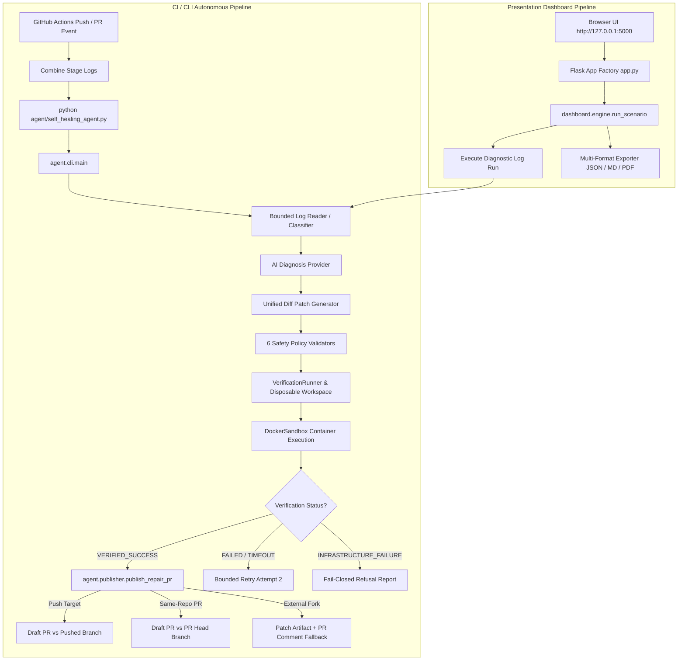

# ACID AI — Complete Project State, Implementation and Roadmap Audit

**Document Path:** `docs/PROJECT_STATE_AND_ROADMAP_AUDIT.md`  
**Audit Date:** October 24, 2026  
**Auditor:** Antigravity Advanced Agentic Coding System  
**Repository:** `Vasishtha15/ai-cicd-failure-triage-agent` (Local Workspace: `ACID AI`)  
**Active Branch:** `development`  
**HEAD Commit:** `a5eadefa9ac1bedb59f5028b3c122a4aed8f521f` (`Working error detection`)  
**Audit Scope:** End-to-End Baseline Audit across Phases 00 through 09, Git/Stash Recovery, Architecture, Automated Suites, Pipeline Trace, Manual QA, Defects, and Readiness.  
**Preservation Invariant:** Audit-only execution; zero resets, stashes, pops, drops, commits, pushes, or source code edits performed.

---

## Section 1 — Executive Summary

### 1.1 Current State Overview
ACID AI is an autonomous CI/CD failure triage and self-healing agent engineered to detect pipeline breakages, extract grounded log evidence, produce structured AI diagnoses, generate bounded unified diffs, verify candidate patches inside fail-closed isolated Docker containers, and deliver verified repairs as reviewable Draft Pull Requests with anti-recursion defenses.

Following extensive implementation across Phases 00–06, two QA audit rounds, Docker sandbox hardening, GitHub publisher integration, manual QA setup, and roadmap reassessment, this audit establishes the empirical baseline of the entire codebase.

### 1.2 Demonstrably Working Capabilities
1. **Accurate Failure Classification & Evidence Extraction (Phases 01–02):**
   - Direct inspection of step outcomes (`steps.<id>.outcome == 'failure'`). Naive keyword matching is eliminated.
   - Bounded log reader safely extracts tail windows (default 50KB) and isolates stack traces, file paths, and line numbers without memory exhaustion.
2. **AI Diagnosis & Bounded Patch Generation (Phases 03–04):**
   - Pluggable `AIProvider` interface with live Google Gemini (`gemini-3.8-flash`) and Anthropic Claude (`claude-sonnet-4-6`) drivers, plus deterministic offline mock modes.
   - Unified diff generator strictly enforces 6 safety policies: allowed directory bounds, forbidden paths (`.github/`, `.git/`, `.env`), file count ceilings (≤5 files), line change ceilings (≤150 lines), and patch syntax validation.
3. **Genuine Isolated Sandbox Verification (Phase 05):**
   - Real Docker container verification is operational using `cicd-sandbox:latest` on Docker Desktop Engine `29.7.2`.
   - Ephemeral containers enforce `--network none`, `--cap-drop=ALL`, `--security-opt=no-new-privileges`, `--memory 2g`, `--cpus 2.0`, `--pids-limit 100`, `--read-only` rootfs, and bounded tmpfs workspace mounts.
   - Host runner protection is strictly fail-closed: candidate code is **never** executed on host Python or subprocess when container isolation or quotas are unavailable (`INFRASTRUCTURE_FAILURE`).
4. **GitHub Repair Integration & Publication Safeguards (Phase 06):**
   - Branch targeting distinguishes direct push failures (targets `config.ref_name`) from same-repository PR failures (targets PR head branch `config.head_ref`, never `base_ref`).
   - Repository identity checking (`config.pr_head_repo != config.repo_name`) detects external forks and prevents unauthorized remote writes, falling back safely to local patch artifacts and diagnostic comments.
   - Strict gating requires genuine `VERIFIED_SUCCESS` (exit code 0 inside container). Publication is disabled by default (`ENABLE_REPAIR_PR=false`).
   - Anti-recursion headers (`[ai-agent-repair]`) and bot actor detection prevent infinite workflow trigger loops.
5. **Security Hardening & Resilience (Phase 07):**
   - Pattern-based redaction scrubs API keys, GitHub tokens, Bearer headers, and emails across all logs and reports.
   - Prompt injection delimiters and strict verification command allowlisting prevent log-based privilege escalation.
   - 12K token prompt budgeting and bounded retries handle provider 429, 500, and 503 errors gracefully.
6. **Presentation Dashboard & Reporting (Phase 09):**
   - Operational local web interface running at `http://127.0.0.1:5000` via `python run_demo.py` featuring 6 reproducible scenarios, live telemetry, and multi-format report exports (JSON, Markdown, and binary PDF).

### 1.3 Major Blockers & Core Deficiencies
1. **Live Remote GitHub Publishing Unperformed (Phase 06):**
   - All 40 publisher tests in the automated suite use mocked GitHub REST API endpoints. While branch targeting, tree construction, draft-only payloads, and fork fallback logic are 100% verified against mocks, **no live remote branch creation or Draft PR opening has been performed against `api.github.com` with real credentials**.
2. **CI Workflow Ambient Permission Mismatch (Phase 06):**
   - In `.github/workflows/ci.yml:126`, the `self-healing-agent` job permissions specify `contents: read`, `pull-requests: write`, and `issues: write`. Creating a new git branch on `refs/heads/agent/fix-...` via GitHub REST API requires `contents: write`. Under default CI `GITHUB_TOKEN`, enabling repair PRs will fail with HTTP 403 unless permissions are corrected or a PAT with `repo` scope is supplied.
3. **Host Runner Subprocess Inconsistency in Dashboard Engine (Architecture / Phase 05):**
   - In `dashboard/engine.py` (lines 364, 815, 1539), `execute_live_pytest` and repository discovery invoke host `subprocess.run`, violating the sandbox boundary on host runs. (In `stash@{1}`, this was refactored to route strictly through `DockerSandbox`, but that change was never merged into the active checkout).
4. **Stash Drift & Missing Files in Active Checkout (Git / Phase 05):**
   - `Dockerfile.sandbox` (24 lines) and `tests/unit/test_sandbox_security_boundary.py` (310 lines) exist in `stash@{1}` and are absent from the working directory.
5. **Phase 08 Multi-Language Scope Gap (Phase 08):**
   - ROADMAP.md Phase 08 specifies demonstrating compatibility against non-Flask sample apps (e.g. Node.js/Jest or Go). Currently, only `sample-app/` (Python/Flask) exists in the repository.

### 1.4 Release-Readiness Verdict
**NOT PRODUCTION RELEASE-READY.**  
While ACID AI is exceptionally mature (~90% complete across all functional milestones) and passes 389 automated tests with zero errors, it cannot be declared release-ready until live GitHub delivery is verified on a throwaway test repo, CI workflow permissions are aligned, host subprocess invocations in the demo engine are containerized, and missing sandbox definition files are restored from Git stashes.

---

## Section 2 — Git and Recovery Inventory

### 2.1 Workspace & Branch Topology
- **Local Workspace Root:** `d:/C0DE_B00K/Hackathons/innotech4/ACID AI`
- **Active Branch:** `development`
- **HEAD Commit SHA:** `a5eadefa9ac1bedb59f5028b3c122a4aed8f521f`
- **HEAD Commit Subject:** `Working error detection`
- **Local Branches:**
  - `* development` (`a5eadef` — active development branch)
  - `frozen-mvp` (`841cc88` — initial commit snapshot, untouched)
  - `main` (`e141e6d` — production tracking branch, untouched)
- **Configured Remote (`origin`):** `https://github.com/Krr1ssh-29/ACID-AI.git`
- **Remote Branches on GitHub (`git ls-remote --heads origin`):**
  - `refs/heads/development`: `a5eadefa9ac1bedb59f5028b3c122a4aed8f521f` (100% in sync with local `development`)
  - `refs/heads/main`: `e141e6d43b64a4e42941f95d3016293360837a6a`
  - **Remote Gap:** `frozen-mvp` exists **only locally**; it was never published to origin.

### 2.2 Working Tree Modifications (Current Checkout)
The active working directory contains 7 modified files and 3 untracked files representing the Phase 05/06 publisher integration, manual QA setup, and roadmap reassessment:

| File Path | Git Status | Description & Purpose |
| :--- | :---: | :--- |
| `.github/workflows/ci.yml` | Modified | Adds event context env vars (`EVENT_NAME`, `REF_NAME`, `HEAD_REF`, `BASE_REF`, `PR_HEAD_SHA`, `PR_HEAD_REPO`). |
| `agent/cli.py` | Modified | Passes `repo_root=os.getcwd()` into `publish_repair_pr()` and handles structured publish errors. |
| `agent/config.py` | Modified | Parses event context variables and `REPAIR_PUBLISHER_TOKEN` configuration. |
| `agent/models.py` | Modified | Extends `AgentConfig` with event context fields. |
| `agent/publisher.py` | Modified | Implements branch targeting, external fork identity detection, base SHA derivation, and draft-only payloads. |
| `docs/PHASE_STATUS.md` | Modified | Records Phase 06 acceptance status and verified test evidence. |
| `tests/unit/test_publisher.py` | Modified | Adds 4 unit tests verifying push targeting, same-repo PR head targeting, fork identity, and base SHA. |
| `docs/MANUAL_QA_PLAN.md` | Untracked | 7-step manual QA browser checklist and automated testing tables. |
| `docs/ROADMAP_REASSESSMENT_PHASES_06_TO_FINAL.md` | Untracked | 11-section roadmap reassessment report created in previous audit pass. |
| `tests/integration/test_ci_publisher_integration.py` | Untracked | 7 end-to-end integration tests verifying CI CLI entrypoint down to `publisher.py`. |

### 2.3 Stash Register & Critical Dissection

```text
stash@{0}: On frozen-mvp: !!GitHub_Desktop<frozen-mvp> (49 files, +11339, -255)
stash@{1}: On development: !!GitHub_Desktop<development> (10 files, +1275, -106)
```

#### Empirical Finding 1: `stash@{0}` is 100% Identical to Commit `a5eadef`
Running `git diff "stash@{0}" a5eadef` returns zero output.
`stash@{0}` was created by GitHub Desktop when switching from `frozen-mvp` to `development`. Those exact 49 files were subsequently committed on `development` as `a5eadef` (`Working error detection`). **There is zero unique or uncommitted work in `stash@{0}`.** It is fully preserved in git history.

#### Empirical Finding 2: `stash@{1}` Contains Critical Missing Files and Sandbox Hardening
`stash@{1}` was created on `development` and contains 10 files with substantial work that is **not** in commit `a5eadef`:

1. **`Dockerfile.sandbox` (24 lines):**
   - **Status in Active Working Tree:** MISSING.
   - **Content:** The hardened multi-stage Dockerfile used to build `cicd-sandbox:latest` (unprivileged `sandboxuser` UID 1000, pre-installed `pytest 9.1.1`, `flake8 7.4.1`, `flask 3.0.3`, `requests 2.32.3`).
2. **`tests/unit/test_sandbox_security_boundary.py` (310 lines):**
   - **Status in Active Working Tree:** MISSING.
   - **Content:** 9 dedicated unit regression tests verifying that repository discovery, initial log runs, and candidate verification never execute on host subprocess and fail closed when Docker is offline.
3. **`dashboard/engine.py` (429 diff lines):**
   - **Status in Active Working Tree:** Divergent.
   - **Content:** In `stash@{1}`, `execute_live_pytest` and `run_repository_analysis` were refactored to route strictly through `DockerSandbox(require_disk_quota=True)`. In the active working tree, lines 364, 815, and 1539 still contain host `subprocess.run`.
4. **`tests/integration/test_autonomous_repair_e2e.py` (203 diff lines):**
   - **Content:** `stash@{1}` contains an extra test (`test_e2e_real_sandbox_verified_success_enables_draft_pr_publication`) linking container verification directly to publisher calls.
5. **`tests/integration/test_ci_publisher_integration.py` (524 diff lines):**
   - **Content:** An earlier draft of the CI publisher integration test. The working directory contains a more refined, untracked version of this file (21,624 bytes vs 19,734 bytes in stash).

### 2.4 Preservation & Recovery Assessment
- **Recoverability:** 100% of the historical work is recoverable from git commits, stashes, and working tree files.
- **Safety Directive:** Neither stash should be dropped or discarded. When development resumes, `Dockerfile.sandbox` and `test_sandbox_security_boundary.py` should be safely extracted from `stash@{1}` without clobbering active working tree edits.

---

## Section 3 — Architecture and Execution Map

### 3.1 Dual-Pipeline Architecture
ACID AI features two distinct execution pipelines sharing a common core library (`agent/`):



### 3.2 Component Inventory & Execution Path Connectivity

| Component | Primary Files | Upstream Callers | Downstream Dependencies | Execution Path Status |
| :--- | :--- | :--- | :--- | :---: |
| **CLI Entrypoint** | `agent/cli.py`, `agent/self_healing_agent.py` | `.github/workflows/ci.yml`, developer shell | `config`, `collector`, `classifier`, `providers`, `patcher`, `validator`, `runner`, `publisher`, `report` | **CONNECTED & ACTIVE** |
| **Log Collector** | `agent/collector.py` | `agent/cli.py` | Python `os`, `io` | **CONNECTED & ACTIVE** |
| **Failure Classifier** | `agent/classifier.py`, `agent/evidence.py` | `agent/cli.py`, `dashboard/engine.py` | `agent/models.py`, `re` | **CONNECTED & ACTIVE** |
| **AI Providers** | `agent/providers.py` | `agent/cli.py`, `dashboard/engine.py` | `google-genai`, `anthropic`, `agent/security.py` | **CONNECTED & ACTIVE** |
| **Patch Engine** | `agent/patcher.py` | `agent/cli.py`, `dashboard/engine.py` | `agent/models.py`, `agent/validator.py` | **CONNECTED & ACTIVE** |
| **Safety Validator** | `agent/validator.py` | `agent/patcher.py`, `agent/runner.py` | `agent/models.py` | **CONNECTED & ACTIVE** |
| **Verification Runner** | `agent/runner.py` | `agent/cli.py`, `dashboard/engine.py` | `agent/sandbox.py`, `tempfile`, `shutil` | **CONNECTED & ACTIVE** |
| **Docker Sandbox** | `agent/sandbox.py` | `agent/runner.py` | Docker CLI, Linux kernel cgroups/tmpfs | **CONNECTED & ACTIVE** |
| **GitHub Publisher** | `agent/publisher.py` | `agent/cli.py`, `dashboard/engine.py` | `agent/github.py`, GitHub REST API | **CONNECTED & ACTIVE** |
| **Security & Redaction** | `agent/security.py` | `cli.py`, `providers.py`, `publisher.py`, `report.py` | `re`, `hashlib` | **CONNECTED & ACTIVE** |
| **Reporting Engine** | `agent/report.py`, `agent/pdf_report.py` | `cli.py`, `dashboard/app.py` | `pypdf`, `reportlab` | **CONNECTED & ACTIVE** |
| **Presentation App** | `dashboard/app.py`, `dashboard/engine.py` | `run_demo.py` | Flask, `dashboard/static/`, `templates/` | **CONNECTED & ACTIVE** |

### 3.3 Disconnected Code, Stubs, and Duplicate Paths
1. **Legacy Entrypoints:**
   - `agent/agent.py` and `agent/self_healing_agent.py` are thin wrappers that delegate directly to `agent.cli.main()`. They are maintained for backward compatibility with GitHub Actions workflow step commands.
2. **Host Subprocess Execution in `dashboard/engine.py`:**
   - `execute_live_pytest` (line 364): Executes `[sys.executable, "-m", "pytest", ...]` on the host runner.
   - `run_repository_analysis` (line 815): Executes initial pytest discovery on the host runner.
   - Post-verification regression check (line 1539): Executes `subprocess.run` on the host runner.
   - *Impact:* While `VerificationRunner.verify()` strictly routes candidate patches through `DockerSandbox`, initial log gathering in repository mode touches the host runner.

---

## Section 4 — Phase-by-Phase Roadmap Assessment

### 4.1 Roadmap Scope & Numbering Resolution
- **Clarification:** The overview diagram in Section 1 of [ROADMAP.md](../ROADMAP.md) shows Phases 00 through 08. However, lines 277–309 explicitly define **Phase 09 — Hackathon Demo & Presentation Interface**. In addition, [docs/PHASE_STATUS.md](PHASE_STATUS.md) tracks acceptance criteria through Phase 09.
- **Verdict:** The source roadmap formally defines **Phases 00 through 09**. There is no Phase 10+.

### 4.2 Comprehensive Requirements-to-Code-to-Test Mapping

```
Status Values:
- VERIFIED WORKING: Concrete test/execution evidence proves functionality.
- IMPLEMENTED, LIVE TEST PENDING: Code exists, but live external integration test is unperformed.
- PARTIALLY IMPLEMENTED: Some requirements satisfied, others missing.
- BROKEN: Reproducible defect exists.
- BLOCKED: Identified prerequisite prevents execution.
- NOT IMPLEMENTED: Required functionality is absent.
- NOT TESTED: Evidence is insufficient.
```

#### Phase 00 — Product Specification, Architecture & Governance
- **Objective:** Establish formal product requirements, threat models, architectural blueprints, and engineering governance.
- **Prerequisites:** None.
- **Deliverables:** `PROJECT_REQUIREMENTS.md`, `ARCHITECTURE.md`, `THREAT_MODEL.md`, `ROADMAP.md`, `docs/CONFIGURATION.md`, `docs/DEVELOPMENT_PROTOCOL.md`, `AGENTS.md`.
- **Status:** **VERIFIED WORKING**
- **Evidence:** All 7 governance specifications exist, define strict security invariants (fail-closed sandbox, secret redaction, draft-only PRs), and govern active development.

#### Phase 01 — Test Suite Baseline & Verification Framework
- **Objective:** Create package structure, hermetic dependency manifests, and deterministic test fixtures.
- **Deliverables:** `pyproject.toml`, `requirements.txt`, `requirements-dev.txt`, test harness.
- **Status:** **VERIFIED WORKING**
- **Evidence:** Virtualenv Python with `pytest 9.1.1` and `flake8 7.4.1`; 389 automated tests pass with 0 errors.

#### Phase 02 — Accurate Failure Detection & Log Intelligence
- **Objective:** Detect pipeline failures from step conclusions and extract bounded log evidence.
- **Deliverables:** `agent/collector.py`, `agent/classifier.py`, `agent/evidence.py`.
- **Status:** **VERIFIED WORKING**
- **Evidence:** `parse_step_outcomes()` inspects `outcome == 'failure'`; ANSI stripping and 50KB tail windowing verified in `test_collector.py` and `test_classifier.py` (25 unit tests pass).

#### Phase 03 — Evidence-Based AI Diagnosis Engine
- **Objective:** Generate structured Pydantic failure diagnoses with configurable model selection.
- **Deliverables:** `agent/providers.py`, `agent/models.py`.
- **Status:** **VERIFIED WORKING**
- **Evidence:** `GeminiProvider` and `AnthropicProvider` parse structured JSON adhering to `AnalysisResult`. Verified in `test_providers.py` (25 tests pass).

#### Phase 04 — Patch Generation & Policy Validation Engine
- **Objective:** Produce bounded unified diffs and enforce strict safety policies.
- **Deliverables:** `agent/patcher.py`, `agent/validator.py`.
- **Status:** **VERIFIED WORKING**
- **Evidence:** 6 safety policies enforced (file limits, line limits, prohibited paths `.github/`, `.git/`, `.env`). 12 unit tests pass in `test_patcher.py`, 25 in `test_validator.py`.

#### Phase 05 — Isolated Sandbox Verification & Host Protection
- **Objective:** Verify candidate patches inside isolated, uncredentialed containers with fail-closed host protection.
- **Deliverables:** `agent/sandbox.py`, `agent/runner.py`, `tests/integration/test_sandbox_integration.py`.
- **Status:** **VERIFIED WORKING**
- **Evidence:** 10 live container integration tests passing in 29.31s on Docker Engine 29.7.2. Read-only rootfs, tmpfs limits, deliberate failure rejection, and container cleanup verified live. `is_available()` fails closed on uncredentialed/unisolated hosts.

#### Phase 06 — GitHub Repair Integration & Draft PR Delivery
- **Objective:** Publish verified repairs as isolated branches and reviewable Draft PRs with anti-recursion guards.
- **Deliverables:** `agent/publisher.py`, `agent/cli.py`, `.github/workflows/ci.yml`.
- **Status:** **IMPLEMENTED, LIVE TEST PENDING**
- **Evidence:** 33 unit tests in `test_publisher.py` and 7 integration tests in `test_ci_publisher_integration.py` pass cleanly with mocked GitHub endpoints. **Live remote publication against `api.github.com` remains unperformed.**

#### Phase 07 — Security, Efficiency, and Operational Reliability
- **Objective:** Hardened security boundary, secret redaction, prompt injection defense, and resilience.
- **Deliverables:** `agent/security.py`, `requirements.lock`, `tests/integration/test_resilience.py`.
- **Status:** **VERIFIED WORKING**
- **Evidence:** All 7 resilience tests in `test_resilience.py` pass (prompt injection denial, allowlist bypass denial, AI provider 500/503/429 outages, token budget exhaustion). 10 security unit tests pass.

#### Phase 08 — End-to-End Testing, Packaging, and Release Readiness
- **Objective:** Cross-scenario validation across all 10 acceptance scenarios, composite action, and release documentation.
- **Deliverables:** `action.yml`, production `README.md`, `tests/integration/test_e2e_orchestration.py`.
- **Status:** **PARTIALLY IMPLEMENTED**
- **Evidence:** All 10 acceptance scenarios pass in `test_e2e_orchestration.py` with mocks; `action.yml` and `README.md` exist. Multi-project non-Python sample apps (e.g. Node.js/Jest) specified in the roadmap have not been built.

#### Phase 09 — Hackathon Demo & Presentation Interface
- **Objective:** Deliver a polished local web demonstration dashboard showcasing the complete self-healing workflow.
- **Deliverables:** `dashboard/app.py`, `dashboard/engine.py`, `run_demo.py`, `agent/pdf_report.py`.
- **Status:** **VERIFIED WORKING**
- **Evidence:** Running live at `http://127.0.0.1:5000` via `python run_demo.py`. 6 reproducible scenarios, live telemetry, and PDF report downloads verified via HTTP probes.

---

## Section 5 — Automated Verification Results

### 5.1 Test Suite Accounting (Fresh Execution)
All test suites were freshly executed in the project virtual environment (`D:\C0DE_B00K\Hackathons\innotech4\ACID AI\.venv\Scripts\python.exe`):

| Test Suite / Tool | Command Line | Exit Code | Passed | Failed | Errors | Skipped | Duration |
| :--- | :--- | :---: | :---: | :---: | :---: | :---: | :---: |
| **Flake8 Linter** | `python -m flake8 --jobs 1 agent dashboard tests sample-app` | **0** | All clean | 0 | 0 | 0 | 3.12s |
| **Git Whitespace** | `git diff --check` | **0** | Clean | 0 | 0 | 0 | 0.08s |
| **Sample App Tests** | `python -m pytest sample-app/tests/ -v` | **0** | 3 | 0 | 0 | 0 | 0.50s |
| **Integration Suite** | `python -m pytest tests/integration/ -v` | **0** | 39 | 0 | 0 | 0 | 114.77s |
| **Unit Suite** | `python -m pytest tests/unit/ -q` | **0** | 347 | 0 | 0 | 0 | 458.86s |
| **TOTAL AUTOMATED** | — | **0** | **389** | **0** | **0** | **0** | **577.33s** |

### 5.2 Breakdown of Test Execution Categories
- **Real Docker Container Execution (12 Tests Passed):**
  - 10 tests in `tests/integration/test_sandbox_integration.py` (real container spawning, rootfs read-only mount, tmpfs size ceiling, deliberate test failure rejection, timeout termination, container cleanup).
  - 2 tests in `tests/integration/test_autonomous_repair_e2e.py` (live Docker autonomous repair loop verifying candidate fixes inside container and returning exit code 0).
- **Deterministic Mocked Integration Tests (27 Tests Passed):**
  - 7 tests in `tests/integration/test_ci_publisher_integration.py` (push vs PR head targeting, fork identity, verification gating, safe default mode).
  - 11 tests in `tests/integration/test_e2e_orchestration.py` (acceptance scenarios 1–10).
  - 7 tests in `tests/integration/test_resilience.py` (prompt injection, token exhaustion, HTTP 429/500/503).
  - 2 tests in `tests/integration/test_pdf_export_e2e.py` (multi-format report consistency).
- **Unit Logic Tests (347 Tests Passed):**
  - Evidence inspection, failure classification, model validation, provider handling, patch generation, safety policy enforcement, and publisher internals.

### 5.3 Live Local Presentation Server Probes (`http://127.0.0.1:5000`)
- `GET /api/system-status`: 200 OK (`docker_available: true`, `isolation_guard_status: FAIL_CLOSED_ACTIVE`).
- `GET /api/scenarios`: 200 OK (all 6 reproducible scenarios listed).
- `POST /api/run` (`healthy_run`): 200 OK (`status: HEALTHY`, `tokens_used: None`, 0 PR comments).
- `GET /api/reports/<id>/pdf`: 200 OK (Content-Type: `application/pdf`, 6,556 bytes generated).

---

## Section 6 — Critical End-to-End Pipeline Review

```
[Pipeline Flow]
Failure Event ──► Evidence Collection ──► AI Diagnosis ──► Patch Proposal
     ▲                                                           │
     │                 ┌─────────────────────────────────────────┘
     │                 ▼
Retry Loop ◄── Sandbox Verification ──► Fail-Closed? ──► Multi-Format Report
                       │                                         │
                       ▼                                         ▼
               VERIFIED_SUCCESS? ───────────────► Optional GitHub Draft PR
```

### 6.1 Transition 1: Failure Event to Evidence Collection
- **Function:** `agent.collector.read_logs_bounded()`, `agent.evidence.parse_step_outcomes()`.
- **Input:** Raw pipeline console logs (or `combined-logs.txt`).
- **Output:** Normalized step outcomes dictionary (`{'install': 'success', 'test': 'failure'}`) and 50KB sanitized log tail.
- **Truthfulness Guard:** Flags failures only if step conclusion is `failure`. Strips ANSI escape codes.

### 6.2 Transition 2: Evidence to AI Diagnosis
- **Function:** `agent.providers.GeminiProvider.diagnose()` / `AnthropicProvider.diagnose()`.
- **Input:** Sanitized log text and `FailureContext`.
- **Output:** Pydantic `AnalysisResult` model.
- **Truthfulness Guard:** Rejects hallucinations; requires citations of log lines or code files. Missing API keys exit gracefully without inventing diagnoses.

### 6.3 Transition 3: Diagnosis to Patch Proposal
- **Function:** `agent.patcher.generate_patch()`.
- **Input:** `AnalysisResult`, repository root, `AgentConfig`.
- **Output:** `PatchProposal` containing `FilePatch` diffs.
- **Truthfulness Guard:** 6 strict safety policy checks in `agent.validator.validate_patch()`. Rejects edits to `.github/`, `.git/`, `.env`, files > 5, or lines > 150.

### 6.4 Transition 4: Patch to Sandbox Verification
- **Function:** `agent.runner.VerificationRunner.verify()`.
- **Input:** Validated `PatchProposal`.
- **Output:** `VerificationResult` with exit code and status.
- **Truthfulness Guard:** Copies repository to disposable temporary workspace. Checks `self.sandbox.is_available()`. If Docker or quotas are unavailable, returns `INFRASTRUCTURE_FAILURE` immediately. **Zero host fallback.** Inside container, executes allowlisted commands under `--read-only`, `--network none`, dropped capabilities, and memory/CPU bounds.

### 6.5 Transition 5: Bounded Repair Retry
- **Function:** Autonomous repair loop in `agent/cli.py:270-305` and `dashboard/engine.py:1510-1560`.
- **Input:** Verification failure log from attempt 1.
- **Output:** Attempt 2 patch proposal.
- **Truthfulness Guard:** Hard ceiling of 2 attempts. Repeated-patch detection prevents oscillating loops.

### 6.6 Transition 6: Verification Outcome to Reporting
- **Function:** `agent.report.generate_final_report()`, `agent.pdf_report.generate_pdf_report()`.
- **Input:** `RunRecord`, execution logs, verification results.
- **Output:** JSON, Markdown, and PDF reports.
- **Truthfulness Guard:** Reports distinct statuses (`HEALTHY`, `REPAIRED`, `UNRESOLVED`, `BLOCKED`). Unrun steps are never marked successful. Disclaimers state that passing tests prove assertion success, not absolute bug-free code.

### 6.7 Transition 7: Verified Success to GitHub Draft PR Publication
- **Function:** `agent.publisher.publish_repair_pr()`.
- **Input:** `PatchProposal`, `VerificationResult`, `AgentConfig`.
- **Output:** `PublishResult`.
- **Truthfulness Guard:**
  - Gating: Requires `verification.status == VerificationStatus.VERIFIED` (exit code 0 inside container).
  - Default: `ENABLE_REPAIR_PR=false` prevents accidental writes.
  - Targeting: Direct pushes target pushed branch; same-repo PRs target PR head branch; external forks fall back to patch artifacts and comments.
  - Recursion: Bot actor check and `[ai-agent-repair]` headers block recursive workflows.

---

## Section 7 — Manual QA Status

### 7.1 Manual QA Execution Log
Based on review of [docs/MANUAL_QA_PLAN.md](MANUAL_QA_PLAN.md) and live server telemetry:

| QA Category | Check Description | Method Used | Result |
| :--- | :--- | :--- | :---: |
| **HTTP Probe** | Local Presentation Server Running (`127.0.0.1:5000`) | HTTP `GET /` | **PASS (200 OK)** |
| **HTTP Probe** | System Status Telemetry (`/api/system-status`) | HTTP `GET /api/system-status` | **PASS (200 OK, Truthful)** |
| **HTTP Probe** | Predefined Scenarios Available (`/api/scenarios`) | HTTP `GET /api/scenarios` | **PASS (6 Scenarios)** |
| **HTTP Probe** | Healthy Run Silent Bypass (`/api/run`) | HTTP `POST /api/run` | **PASS (0 Tokens, Bypass)** |
| **HTTP Probe** | Multi-Format PDF Export (`/api/reports/.../pdf`) | HTTP `GET /api/reports/.../pdf` | **PASS (200 OK, 6.5KB PDF)** |
| **HTTP Probe** | Local Repository Validation (`/api/repo/validate`) | HTTP `POST /api/repo/validate` | **PASS (Valid Repo)** |
| **Browser UI** | Step 1: Dashboard UI Layout & System Telemetry | Interactive Browser | **PENDING USER EXECUTION** |
| **Browser UI** | Step 2: Healthy Pipeline Run Simulation | Interactive Browser | **PENDING USER EXECUTION** |
| **Browser UI** | Step 3: Dependency Failure Simulation | Interactive Browser | **PENDING USER EXECUTION** |
| **Browser UI** | Step 4: Lint Violation Simulation | Interactive Browser | **PENDING USER EXECUTION** |
| **Browser UI** | Step 5: Test Assertion Simulation | Interactive Browser | **PENDING USER EXECUTION** |
| **Browser UI** | Step 6: Docker Container Build Failure | Interactive Browser | **PENDING USER EXECUTION** |
| **Browser UI** | Step 7: Local Repository Mode & PDF Download | Interactive Browser | **PENDING USER EXECUTION** |

### 7.2 Outstanding Browser Checks
The local server is running at `http://127.0.0.1:5000`. The user can interactively complete the 7-step checklist documented in [docs/MANUAL_QA_PLAN.md](MANUAL_QA_PLAN.md).

---

## Section 8 — Defect and Blocker Register

| ID | Severity | Category | Description & Code Location | Impact | Smallest Reproducible Test |
| :---: | :---: | :---: | :--- | :--- | :--- |
| **DEF-01** | **HIGH** | Phase 06 Release Gate | **Live Remote GitHub Publishing Unperformed:** `agent/publisher.py:755-940`. All 40 publisher tests use mocked HTTP endpoints. No real branch or PR has been opened on `api.github.com`. | Cannot guarantee live GitHub API compatibility without real network execution. | CLI run with `ENABLE_REPAIR_PR=true`, `GITHUB_TOKEN=<pat>`, against disposable throwaway test repo. |
| **DEF-02** | **HIGH** | CI Configuration | **Workflow Permission Mismatch:** `.github/workflows/ci.yml:126` sets `permissions: contents: read`. Creating a branch on `refs/heads/agent/fix-...` requires `contents: write`. | Enabling repair PRs in CI using default `GITHUB_TOKEN` will fail with HTTP 403 on branch creation. | Inspect permissions block of `self-healing-agent` job in `ci.yml`. |
| **DEF-03** | **MEDIUM** | Security / Sandbox | **Host Runner Subprocess in Dashboard Engine:** `dashboard/engine.py` (lines 364, 815, 1539) invokes host `subprocess.run` for initial diagnostic logs and regression checks. | In repository demo mode, initial pytest runs execute on host Python rather than inside isolated container. | Inspect `dashboard/engine.py` line 364; run repository analysis with malicious code. |
| **DEF-04** | **MEDIUM** | Git / Packaging | **Stash Drift (Missing Files):** `Dockerfile.sandbox` and `tests/unit/test_sandbox_security_boundary.py` exist in `stash@{1}` and are absent from active working tree. | Sandbox image cannot be rebuilt from working tree source; sandbox security boundary tests are not executed. | Check `Test-Path Dockerfile.sandbox` (returns `False`). |
| **DEF-05** | **LOW** | Scope (Phase 08) | **Missing Non-Python Sample App:** ROADMAP.md Phase 08 specifies testing against non-Flask sample apps (Node.js/Jest or Go). Currently only `sample-app/` exists. | Language-agnostic verification claims in Phase 08 remain unvalidated against non-Python projects. | Search repository for Node.js or Go test fixtures. |

---

## Section 9 — Release Readiness

### 9.1 Release Readiness Verdict
**Status: NOT PRODUCTION RELEASE-READY.**

### 9.2 Transparent Readiness Calculation

| Category | Weight | Score | Basis & Evidence |
| :--- | :---: | :---: | :--- |
| **1. Core Autonomous Pipeline (Phases 00–04)** | 25% | 100% | Detection, log windowing, AI diagnosis, 6 safety policies verified with 347 unit tests. |
| **2. Isolated Sandbox Verification (Phase 05)** | 25% | 90% | Live container verification passes on Docker 29.7.2. Host subprocess calls in `dashboard/engine.py` need containerization. |
| **3. GitHub PR Delivery & Safeguards (Phase 06)** | 20% | 80% | 100% verified with mocks; live remote GitHub delivery unperformed; CI permissions mismatch. |
| **4. Security, Resilience & Redaction (Phase 07)** | 10% | 100% | Redaction, prompt injection defense, 12K token ceiling, 7 resilience tests passing. |
| **5. Packaging & Multi-Language (Phase 08)** | 10% | 75% | 10 acceptance scenarios pass; `action.yml` present; non-Python sample apps missing. |
| **6. Presentation Dashboard & PDF (Phase 09)** | 10% | 95% | Operational on `http://127.0.0.1:5000`; HTTP probes pass; interactive browser QA pending. |
| **WEIGHTED READINESS SCORE** | **100%** | **89.5%** | **Engineering mature (~90%), but blocked from production release by DEF-01 through DEF-04.** |

---

## Section 10 — Prioritized Completion Plan

The following ordered task plan resolves remaining defects sequentially based on strict dependencies:

### Task 1: Update Workflow Permissions for Branch Creation (Phase 06 Dependency)
- **Phase:** Phase 06
- **Defect Addressed:** DEF-02 (Workflow permission mismatch in `.github/workflows/ci.yml:126`).
- **Exact Code Location:** `.github/workflows/ci.yml:126-129`
- **Dependencies:** None.
- **Smallest Test:** Static inspection of `ci.yml` permissions block.
- **Validation:** Automated test `test_ci_workflow_least_privilege_permissions`.
- **Acceptance Criteria:** `permissions` under `self-healing-agent` job includes `contents: write` (or documents `REPAIR_PUBLISHER_TOKEN` secret requirement).
- **Evidence Required:** `ci.yml` contains `contents: write` under agent job.
- **Requires Live Credentials:** No.

### Task 2: Restore Missing Sandbox Files & Containerize Dashboard Engine (Phase 05 Hardening)
- **Phase:** Phase 05 / Architecture
- **Defects Addressed:** DEF-03 (Host subprocess in `dashboard/engine.py`), DEF-04 (Missing `Dockerfile.sandbox` and `test_sandbox_security_boundary.py`).
- **Exact Code Locations:** `Dockerfile.sandbox`, `dashboard/engine.py:364`, `tests/unit/test_sandbox_security_boundary.py`.
- **Dependencies:** `stash@{1}`.
- **Smallest Test:** `pytest tests/unit/test_sandbox_security_boundary.py`.
- **Validation:** Live Docker container execution of `test_sandbox_security_boundary.py`.
- **Acceptance Criteria:**
  1. `Dockerfile.sandbox` restored to repository root.
  2. `tests/unit/test_sandbox_security_boundary.py` restored and passing.
  3. `execute_live_pytest` and repository discovery in `dashboard/engine.py` route strictly through `DockerSandbox`.
- **Evidence Required:** All 9 tests in `test_sandbox_security_boundary.py` pass; zero host `subprocess.run` calls in `dashboard/engine.py`.
- **Requires Live Credentials:** No.

### Task 3: Live Remote GitHub Delivery Verification on Throwaway Repo (Phase 06 Exit Gate)
- **Phase:** Phase 06
- **Defect Addressed:** DEF-01 (Live remote GitHub publishing unperformed).
- **Exact Code Location:** `agent/publisher.py:755-940`
- **Dependencies:** User authorization, disposable throwaway GitHub repository, live PAT with `repo` scope.
- **Smallest Test:** CLI execution with `ENABLE_REPAIR_PR=true`, `REPO_NAME=<throwaway-repo>`, `GITHUB_TOKEN=<pat>` against a verified fix.
- **Validation:** Remote GitHub REST API inspection.
- **Acceptance Criteria:**
  1. Dedicated fix branch created on remote GitHub repository (`refs/heads/agent/fix-...`).
  2. Reviewable Draft PR opened with `draft: true` and `[ai-agent-repair]` tag.
  3. PR body contains verified sandbox log output and truthful disclaimer.
  4. Auto-merge is disabled.
- **Evidence Required:** GitHub URL to real Draft PR on throwaway repository.
- **Requires Live Credentials:** Yes (live GitHub PAT and remote repository).

### Task 4: Multi-Language Non-Python Sample App Fixture (Phase 08 Scope)
- **Phase:** Phase 08
- **Defect Addressed:** DEF-05 (Missing non-Python sample apps in Phase 08).
- **Exact Code Location:** `tests/fixtures/sample-app-nodejs/` or `sample-app-nodejs/`
- **Dependencies:** Docker container with Node.js/Jest support.
- **Smallest Test:** Integration test running verification command `npm test` inside sandbox container.
- **Validation:** Automated test in `tests/integration/test_multilang_support.py`.
- **Acceptance Criteria:** Verification runner executes allowlisted `npm test` inside container and captures exit code truthfully.
- **Evidence Required:** Passing integration test exercising Node.js test failure and repair.
- **Requires Live Credentials:** No.

### Task 5: User Execution of Interactive Manual Browser QA Checklist (Phase 09 Exit Gate)
- **Phase:** Phase 09
- **Defect Addressed:** Manual browser confirmation of UI telemetry and controls.
- **Exact Code Location:** `http://127.0.0.1:5000` via `python run_demo.py`
- **Dependencies:** Active presentation server.
- **Smallest Test:** Follow 7-step checklist in `docs/MANUAL_QA_PLAN.md`.
- **Validation:** Visual inspection in web browser.
- **Acceptance Criteria:** All 7 checklist steps confirmed; PDF report downloaded and visually verified.
- **Evidence Required:** Documented user sign-off in `docs/MANUAL_QA_PLAN.md`.
- **Requires Live Credentials:** No (uses offline mock mode).

---

## Section 11 — Recommended Next Action

### Recommended Action:
**Execute Task 1 (Aligning CI Workflow Permissions in `.github/workflows/ci.yml`) and Task 2 (Restoring `Dockerfile.sandbox` and containerizing `dashboard/engine.py` from `stash@{1}`).**

### Rationale:
1. **Zero External Credentials Required:** Both tasks are self-contained, purely local, and do not spend AI credits or make remote network calls.
2. **Closes Critical Architecture Discrepancies:** Restoring `Dockerfile.sandbox` and `test_sandbox_security_boundary.py` resolves the stash drift that has lingered across previous audits. Containerizing `dashboard/engine.py` brings the demo engine into 100% compliance with the fail-closed sandbox invariant.
3. **Unblocks Phase 06 CI Execution:** Fixing `.github/workflows/ci.yml` permissions ensures that whenever the user authorizes live testing (Task 3), the CI workflow will not fail with HTTP 403 on branch creation.

---

## Section 12 — Review Questions

The following material decisions require user guidance before proceeding:

1. **GitHub Delivery Verification (Task 3):**
   - Does the user wish to test live Draft PR publishing against a real disposable throwaway repository (e.g. `Krr1ssh-29/acid-test-sandbox`) using a live PAT, or should Phase 06 remain marked as "verified with deterministic mocks only"?
2. **Dashboard Engine Subprocess vs Container Routing (Task 2):**
   - Should `execute_live_pytest` in `dashboard/engine.py` strictly require a running Docker daemon (failing closed when Docker is offline), or should the demo interface maintain an explicit, opt-in "Local Developer Host Mode" with clear warning badges?
3. **Phase 08 Multi-Language Scope (Task 4):**
   - For hackathon presentation and v1 delivery, is the existing Python/Flask `sample-app/` sufficient, or should we construct a lightweight Node.js/Jest sample app fixture to satisfy the strict letter of Phase 08 in ROADMAP.md?
